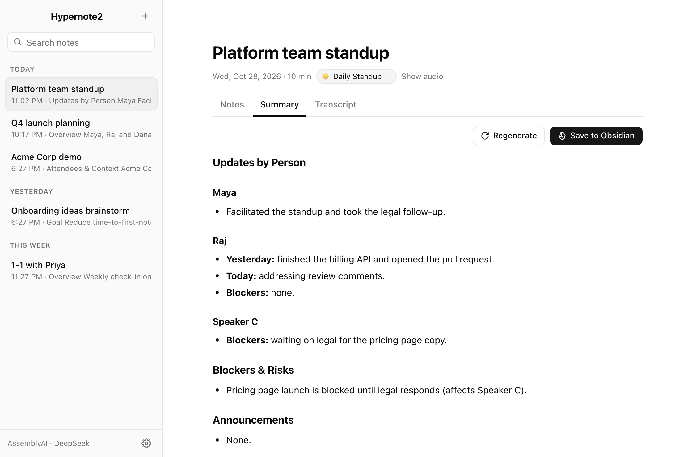
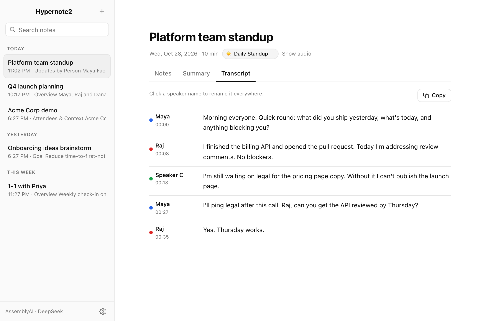
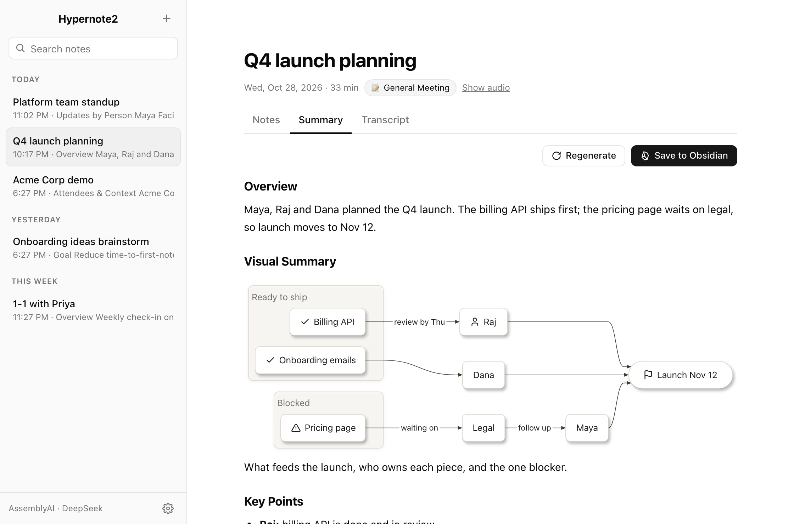
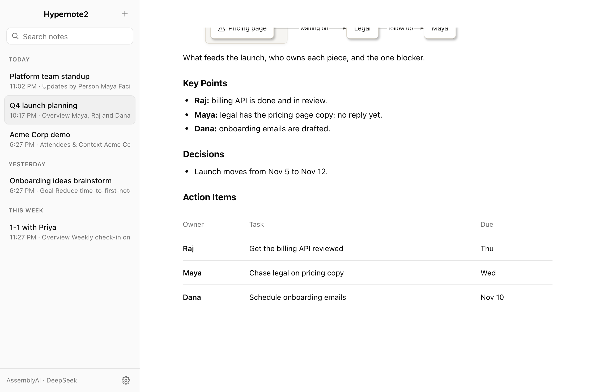
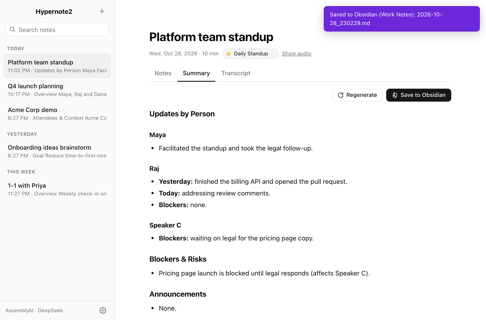
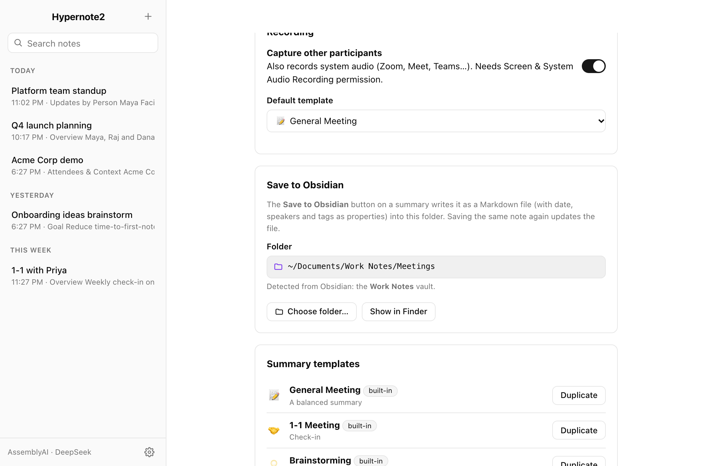

# Hypernote2

A tiny, all-cloud meeting notepad for macOS, modelled on [Hyprnote](https://github.com/fastrepl/hyprnote)'s look and feel. Record a meeting, get a transcript with speaker labels, and a summary shaped by a template.





> The screenshots are the real `web/` UI rendered with sample data (`scripts/screenshot`), not a capture of the native window.

## Features

- **Speaker-labelled transcripts** from AssemblyAI (`speaker_labels`). Click a speaker name to rename it.
- **Template summaries** from DeepSeek Flash, streamed as they're written: General, 1-1, Brainstorming, Daily Standup, Customer Demo, plus your own (Settings → Summary templates).
- **Visual summaries.** The General Meeting template adds a Mermaid diagram of the meeting and an action-item table. The app draws diagrams with [Pele](https://github.com/obsidianmd/pele) in a white "paper" style with drop shadows.
- **Save to Obsidian.** One click writes the summary as a Markdown file into your Obsidian vault (detected automatically), with date, speakers and tags as properties.
- **Your notes count.** What you type during the meeting steers the summary.
- **Menu bar app** with Start/Stop Recording, and optional **Launch at Login**.
- **Nothing to download.** No models, no local inference; the built app is under 2 MB.

Transcription runs **after** you press Stop (the audio file is uploaded to AssemblyAI), not live.

## Setup page

On first launch Hypernote2 asks for two keys:

| Key | Used for | Get one |
|---|---|---|
| AssemblyAI | transcription + speaker diarization | assemblyai.com/dashboard |
| DeepSeek | summaries (Flash model, detected automatically) | platform.deepseek.com/api_keys |

Each key is verified against its provider before it is saved to the macOS Keychain. You can replace them later in Settings.

## Build & run

Requires macOS 14+ and the Xcode toolchain.

```bash
./scripts/build-app.sh        # -> build/Hypernote2.app
open build/Hypernote2.app
./scripts/build-app.sh --install   # build, copy to /Applications and relaunch
swift test                    # parsing, prompts, storage, controller (offline, network stubbed)
```

In restricted shells, prefix with `SWIFT_BUILD_FLAGS=--disable-sandbox`.

## Launch at login

Click the waveform icon in the menu bar and toggle **Launch at Login** (a checkmark means it's on). While the window is open you can also right-click the Dock icon for the same item. This uses macOS's login-item API, so it also shows up in System Settings → General → Login Items.

If Launch at Login is on, each launch re-registers the copy that is running, so the login item follows the app when you reinstall it into `/Applications`.

If macOS refuses (it can for apps outside `/Applications`), move `Hypernote2.app` to `/Applications` and try again. If it asks for approval, Hypernote2 opens the Login Items pane for you.

## Diagrams & tables

The **General Meeting** template now has a **Visual Summary** section: DeepSeek picks the diagram type that fits the meeting (a flowchart from topics to decisions to owners, a mindmap, a timeline, a sequence of hand-offs or a gantt chart) and writes it as a ` ```mermaid ` block. **Action Items** are a table with the columns Owner, Task and Due.





- **In the app** diagrams are drawn by stock Pele 1.12 (bundled in `web/vendor/`, MIT), styled only through Pele's CSS variables and class hooks, as discussed in [obsidianmd/pele#24](https://github.com/obsidianmd/pele/issues/24): white paper cards with a soft drop shadow (an SVG filter, because WebKit doesn't draw CSS `drop-shadow()` on SVG shapes). Labels may use `fa:fa-check`, `fa:fa-x`, `fa:fa-user`, `fa:fa-users`, `fa:fa-calendar`, `fa:fa-clock`, `fa:fa-flag` and `fa:fa-warning`, which are drawn with [Lucide](https://lucide.dev) icons through Pele's `icons` option.
- **In Obsidian** the same blocks render as regular Mermaid diagrams, and tables as Obsidian tables.
- Tables follow the [pele.run](https://pele.run) docs style: rules between rows, quiet headers, a bold first column.
- A diagram that can't be parsed is shown as its source with the error underneath, so nothing is lost.
- Your own templates can ask for diagrams too: mention "Mermaid diagram" in a section description.
- Markdown itself is rendered by the app's small built-in renderer (`web/markdown.js`); Pele only draws diagrams.

## Save to Obsidian

The **Save to Obsidian** button on the Summary tab writes the note to a `.md` file. If the folder isn't inside an Obsidian vault, the button reads **Save .md** instead.



- **Default folder:** `<vault>/Meetings`. Hypernote2 reads Obsidian's vault list (`~/Library/Application Support/obsidian/obsidian.json`) and uses the vault that's open in Obsidian, or else the one you used most recently. Without Obsidian it falls back to `~/Documents/Hypernote2`.
- **Change it** in Settings → Save to Obsidian: **Choose folder…** picks any folder, **Use Obsidian default** goes back to the detected vault, and **Show in Finder** opens the folder.
- **File name:** the note's start date and time, e.g. `2026-09-25_093034.md` (the title is inside the file). It doesn't change when you rename the note, so saving again overwrites the same file; re-save after you regenerate a summary.
- **Contents:** YAML properties (`title`, `date`, `time`, `duration_min`, `template`, `speakers`, `tags: [meeting, hypernote]`), then `# Title`, the summary, and your notes under `## My Notes`.



The transcript tab still has a **Copy** button for the plain-text transcript.

## How it works

1. **Start recording** (window button or menu bar). Microphone audio, plus system audio if you allow it, is mixed into a mono 16 kHz AAC file (about 14 MB/hour).
2. **Stop** uploads the file to AssemblyAI, which returns diarized utterances.
3. DeepSeek turns the transcript, your notes and the note's template into a Markdown summary, then suggests a title.

Architecture in short: a SwiftUI menu bar app hosts a `WKWebView` (`web/`, plain HTML/CSS/JS) and talks to Swift through a small message bridge. All logic lives in the `HypernoteCore` library. See [PLAN.md](PLAN.md) for how it was built and why.

Data lives in `~/Library/Application Support/Hypernote2/` (one JSON file and `audio.m4a` per note). Markdown exports are separate copies in your chosen folder.

## Permissions

- **Microphone** (required).
- **Screen & System Audio Recording** (optional): lets Hypernote2 capture the other side of calls. Without it, only your microphone is recorded and the app tells you so.

## Regenerating the screenshots

```bash
cd scripts/screenshot && npm install
CHROME_PATH=/path/to/chrome-or-headless-shell npm run shots
```

## License

GPL-3.0 (see `LICENSE`). The UI styling and app icon are derived from Hyprnote (GPL-3.0). Bundled: [Pele](https://github.com/obsidianmd/pele) (MIT, `web/vendor/PELE-LICENSE`); icon paths from [Lucide](https://lucide.dev) (ISC).
